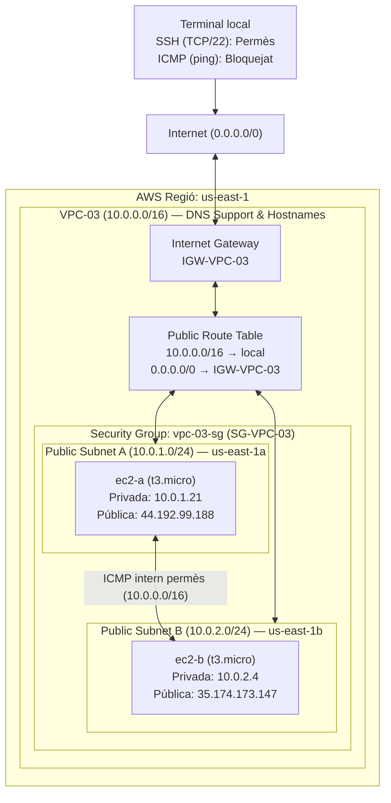
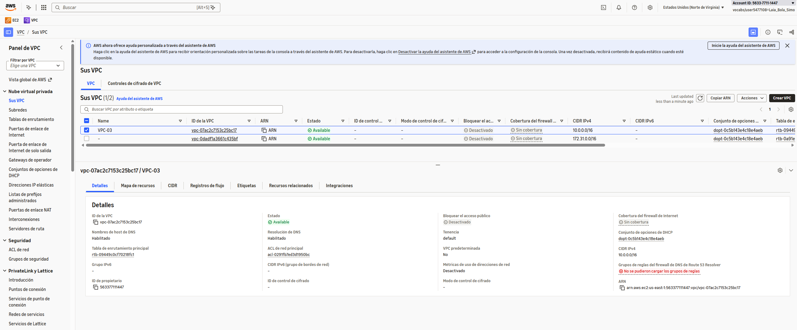
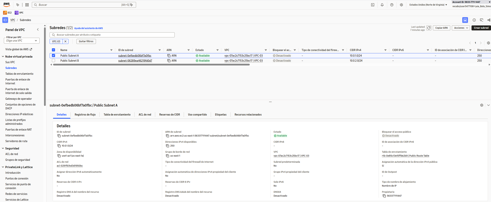
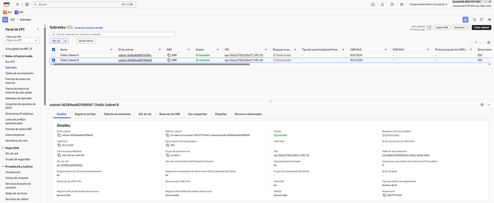
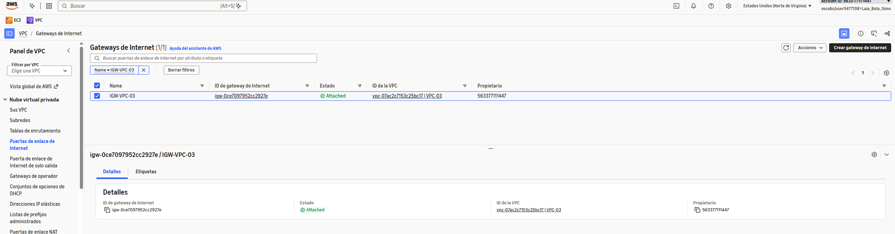
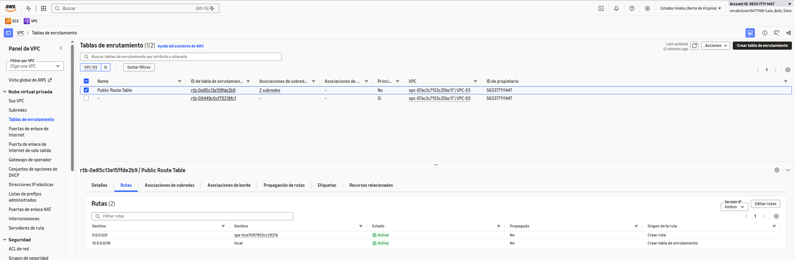
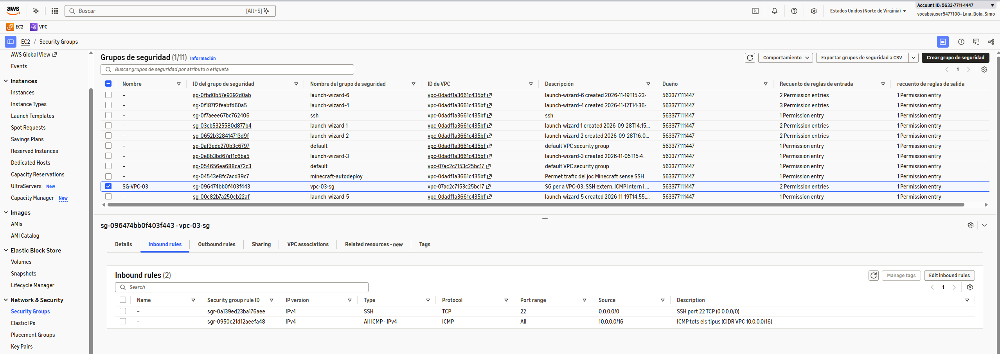
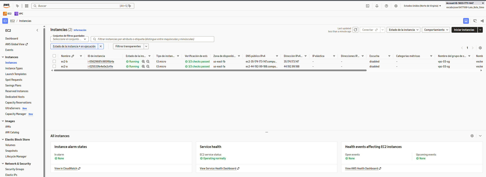

# Pràctica Pt2.2 — Infraestructura com a Codi (IaC) a AWS amb Terraform

- **Alumna:** Laia Bola Simó
- **Mòdul:** OPT Cloud Computing - ASIX2
- **Curs:** 2026-2027

---

## 1. Objectiu de la pràctica

L'objectiu d'aquesta pràctica és desplegar de manera completament automatitzada, mitjançant **Terraform**, una arquitectura de xarxa pública multi-AZ a **Amazon Web Services (AWS)** a la regió `us-east-1`, amb dues instàncies EC2 basades en Amazon Linux 2023 i un control estricte del tràfic mitjançant un Security Group:

- Accés administratiu **SSH (TCP/22)** obert des d'Internet (`0.0.0.0/0`).
- Tràfic **ICMP** permès **únicament** dins del rang intern de la VPC (`10.0.0.0/16`) i bloquejat des de l'exterior.
- Sortida completa a Internet (`0.0.0.0/0`) a través d'un Internet Gateway.

---

## 2. Arquitectura desplegada

La infraestructura desplegada consta d'una VPC pròpia (`VPC-03`) dividida en dues subxarxes públiques ubicades en dues Availability Zones diferents (`us-east-1a` i `us-east-1b`), connectades a Internet mitjançant un Internet Gateway i una taula d'encaminament pública compartida.



### Resum dels recursos creats

| Recurs Terraform | Nom / Tag `Name` | Identificador AWS | Configuració principal |
| :--- | :--- | :--- | :--- |
| `aws_vpc.vpc_03` | `VPC-03` | `vpc-07ac2c7153c25bc17` | CIDR `10.0.0.0/16`, DNS Support i DNS Hostnames activats |
| `aws_subnet.public_subnet_a` | `Public Subnet A` | `subnet-0efbedb06bf7a0fbc` | CIDR `10.0.1.0/24`, AZ `us-east-1a`, IP pública automàtica |
| `aws_subnet.public_subnet_b` | `Public Subnet B` | `subnet-06289ea46219fd0d7` | CIDR `10.0.2.0/24`, AZ `us-east-1b`, IP pública automàtica |
| `aws_internet_gateway.igw` | `IGW-VPC-03` | `igw-0ce7097952cc2927e` | Associat a `VPC-03` |
| `aws_route_table.public_rt` | `Public Route Table` | `rtb-0e85c13e15ffde2b9` | Ruta `0.0.0.0/0` → `IGW-VPC-03`, associada a ambdues subxarxes |
| `aws_security_group.sg_vpc_03` | `SG-VPC-03` (`vpc-03-sg`) | `sg-096474bb0f403f443` | Ingress SSH (`0.0.0.0/0`), Ingress ICMP (`10.0.0.0/16`), Egress total (`0.0.0.0/0`) |
| `aws_instance.ec2_a` | `ec2-a` | `i-025533fe4e0e2c41e` | `t3.micro`, AL2023 (`ami-062caee4b7b602eb0`), `Public Subnet A`, clau `vockey` |
| `aws_instance.ec2_b` | `ec2-b` | `i-05629687c985f6b4a` | `t3.micro`, AL2023 (`ami-062caee4b7b602eb0`), `Public Subnet B`, clau `vockey` |

---

## 3. Estructura de carpetes i fitxers

```text
pt2-2/
├── .gitignore
├── main.tf
├── outputs.tf
├── README.md
└── assets/
    ├── 01-vpc.png
    ├── 02-subnets.png
    ├── 02-subnets-b.png
    ├── 03-igw.png
    ├── 04-route-table.png
    ├── 05-security-group.png
    └── 06-ec2-instances.png
```

### Fitxer `.gitignore`

S'ha configurat el fitxer `.gitignore` dins de `pt2-2/` per evitar pujar al repositori Git fitxers binaris pesants del proveïdor, fitxers d'estat que poden contenir dades sensibles de la infraestructura i claus privades SSH:

```gitignore
.terraform/
*.tfstate
*.tfstate.backup
.terraform.lock.hcl
*.pem
```

---

## 4. Explicació del codi Terraform

### 4.1. Proveïdor i xarxa (`main.tf`)

- **Proveïdor AWS:** Es configura el proveïdor oficial `hashicorp/aws` (`~> 5.0`) apuntant a la regió `us-east-1`.
- **VPC (`aws_vpc.vpc_03`):** Defineix el bloc CIDR `10.0.0.0/16` amb `enable_dns_support = true` i `enable_dns_hostnames = true` perquè les instàncies puguin resoldre noms DNS interns i externs i rebre noms d'amfitrió DNS públics.
- **Subxarxes públiques (`aws_subnet.public_subnet_a` i `aws_subnet.public_subnet_b`):** Es creen `10.0.1.0/24` a `us-east-1a` i `10.0.2.0/24` a `us-east-1b`, totes dues amb `map_public_ip_on_launch = true` per assignar automàticament una IPv4 pública a cada instància llançada.
- **Internet Gateway i Route Table (`aws_internet_gateway.igw`, `aws_route_table.public_rt`, `aws_route_table_association`):** L'IGW proporciona sortida a Internet a `VPC-03`. La taula d'encaminament pública afegeix la ruta per defecte `0.0.0.0/0` cap a l'IGW (a banda de la ruta implícita `10.0.0.0/16 -> local` que crea AWS) i s'associa explícitament a les dues subxarxes públiques.

### 4.2. Security Group (`aws_security_group.sg_vpc_03`)

El Security Group s'assigna a `VPC-03` i implementa exactament tres regles (els Security Groups d'AWS són *stateful*, de manera que el tràfic de resposta del tràfic permès s'autoritza automàticament):

| Direcció | Protocol | Ports | Origen / Destinació | Funció |
| :--- | :--- | :--- | :--- | :--- |
| **Ingress** | TCP | `22` | `0.0.0.0/0` | Permet l'accés administratiu SSH des de l'exterior |
| **Ingress** | ICMP | `-1` (tots els tipus) | `10.0.0.0/16` (`aws_vpc.vpc_03.cidr_block`) | Permet `ping`/ICMP únicament entre recursos interns de `VPC-03` |
| **Egress** | `-1` (tot el tràfic) | `0` (tots) | `0.0.0.0/0` | Permet tota la sortida cap a Internet i la pròpia VPC |

### 4.3. Selecció dinàmica d'AMI i instàncies EC2

Mitjançant el bloc `data "aws_ami" "al2023"` es consulta dinàmicament l'última AMI oficial d'**Amazon Linux 2023** (`owners = ["amazon"]`, arquitectura `x86_64`, virtualització `hvm`, disc arrel `ebs` i filtre `al2023-ami-2023.*-kernel-*-x86_64` per excloure imatges mínimes). En aquest desplegament s'ha resolt automàticament a:

- **AMI ID:** `ami-062caee4b7b602eb0`
- **Nom:** `al2023-ami-2023.12.20261120.0-kernel-6.1-x86_64`

A continuació es despleguen les dues instàncies `t3.micro` amb el parell de claus `vockey` i el Security Group `sg_vpc_03`:
- **`ec2-a`** dins de `Public Subnet A` (`us-east-1a`).
- **`ec2-b`** dins de `Public Subnet B` (`us-east-1b`).

### 4.4. Sortides (`outputs.tf`)

El fitxer `outputs.tf` exposa les adreces IP públiques i privades d'ambdues instàncies un cop finalitzat el desplegament:

- `ec2_a_public_ip` i `ec2_a_private_ip`
- `ec2_b_public_ip` i `ec2_b_private_ip`

---

## 5. Desplegament per terminal

Des de la carpeta `pt2-2/`, s'han executat els passos estàndard del cicle de vida de Terraform:

```powershell
terraform init
terraform validate
terraform apply -auto-approve
```

### Resultat obtingut

1. **`terraform init`:** S'ha descarregat i inicialitzat el proveïdor `hashicorp/aws v5.100.0`.
2. **`terraform validate`:** Validació sintàctica i semàntica correcta (`Success! The configuration is valid.`).
3. **`terraform apply -auto-approve`:** S'han creat correctament els 10 recursos definits:

```text
Apply complete! Resources: 10 added, 0 changed, 0 destroyed.

Outputs:

ec2_a_private_ip = "10.0.1.21"
ec2_a_public_ip = "44.192.99.188"
ec2_b_private_ip = "10.0.2.4"
ec2_b_public_ip = "35.174.173.147"
```

---

## 6. Verificacions a la consola web d'AWS

A continuació es documenta la verificació visual dels recursos desplegats directament des de la consola d'AWS (`us-east-1`):

### 6.1. VPC (`VPC-03`)
Es comprova l'existència de `VPC-03` (`vpc-07ac2c7153c25bc17`) amb CIDR `10.0.0.0/16` en estat *Available* i amb la resolució DNS i els noms d'amfitrió DNS habilitats.



### 6.2. Subxarxes públiques (`Public Subnet A` i `Public Subnet B`)
Es verifiquen les dues subxarxes associades a `VPC-03`: `Public Subnet A` (`10.0.1.0/24` a `us-east-1a`) i `Public Subnet B` (`10.0.2.0/24` a `us-east-1b`), amb l'assignació automàtica d'IPv4 pública activada.





### 6.3. Internet Gateway (`IGW-VPC-03`)
Es verifica l'Internet Gateway `IGW-VPC-03` (`igw-0ce7097952cc2927e`) en estat *Attached* i vinculat a `VPC-03`.



### 6.4. Taula d'encaminament (`Public Route Table`)
Es comprova la taula d'encaminament `Public Route Table` (`rtb-0e85c13e15ffde2b9`) amb la ruta local `10.0.0.0/16 -> local`, la ruta per defecte `0.0.0.0/0 -> igw-0ce7097952cc2927e` i l'associació explícita a `Public Subnet A` i `Public Subnet B`.



### 6.5. Security Group (`SG-VPC-03`)
Es verifiquen les regles exactes configurades a `vpc-03-sg` (`sg-096474bb0f403f443`): entrada SSH (`TCP/22`) des de `0.0.0.0/0`, entrada *All ICMP - IPv4* restringida a `10.0.0.0/16` i sortida oberta (`All traffic` cap a `0.0.0.0/0`).



### 6.6. Instàncies EC2 (`ec2-a` i `ec2-b`)
Es comproven les dues instàncies `t3.micro` en estat *Running* i amb les comprovacions d'estat correctes: `ec2-a` (`10.0.1.21` / `44.192.99.188`) a `us-east-1a` i `ec2-b` (`10.0.2.4` / `35.174.173.147`) a `us-east-1b`.



---

## 7. Proves de connectivitat per terminal

### 7.1. Connexió SSH a `ec2-a`

La clau privada `labsuser.pem` s'ha localitzat a `%USERPROFILE%\.aws\labsuser.pem`. A Windows, OpenSSH exigeix restringir els permisos ACL del fitxer `.pem` abans d'acceptar-lo com a clau privada:

```powershell
icacls "$env:USERPROFILE\.aws\labsuser.pem" /inheritance:r /grant:r "$($env:USERNAME):(R)"
ssh -o StrictHostKeyChecking=no -i "$env:USERPROFILE\.aws\labsuser.pem" ec2-user@44.192.99.188
```

La connexió SSH s'ha establert correctament amb l'amfitrió `ip-10-0-1-21.ec2.internal`, confirmant que la regla d'entrada TCP/22 (`0.0.0.0/0`), la ruta pública cap a l'IGW i la clau `vockey` funcionen correctament.

### 7.2. Verificació d'ICMP intern (`ec2-a` → `ec2-b`)

Des de dins d'`ec2-a` (`10.0.1.21`, a `us-east-1a`) s'ha executat un `ping` cap a la IP privada d'`ec2-b` (`10.0.2.4`, a `us-east-1b`):

```bash
ping -c 4 10.0.2.4
```

Sortida obtinguda:

```text
PING 10.0.2.4 (10.0.2.4) 56(84) bytes of data.
64 bytes from 10.0.2.4: icmp_seq=1 ttl=127 time=1.58 ms
64 bytes from 10.0.2.4: icmp_seq=2 ttl=127 time=0.437 ms
64 bytes from 10.0.2.4: icmp_seq=3 ttl=127 time=0.430 ms
64 bytes from 10.0.2.4: icmp_seq=4 ttl=127 time=0.461 ms

--- 10.0.2.4 ping statistics ---
4 packets transmitted, 4 received, 0% packet loss, time 3049ms
rtt min/avg/max/mdev = 0.430/0.728/1.584/0.494 ms
```

**Conclusió:** Els 4 paquets s'han rebut amb `0% packet loss` i latència inferior a 1 ms de mitjana entre les dues AZ. Això demostra que l'encaminament intern de `VPC-03` (`10.0.0.0/16 -> local`) i la regla d'entrada ICMP restringida a `10.0.0.0/16` funcionen correctament.

### 7.3. Verificació de sortida a Internet des d'`ec2-a`

Des de la mateixa sessió SSH a `ec2-a`, s'ha comprovat la resolució DNS i la sortida HTTPS cap a Internet:

```bash
curl -I https://aws.amazon.com
```

Sortida obtinguda:

```text
HTTP/2 200
content-type: text/html;charset=utf-8
date: Sun, 22 Nov 2026 16:02:34 GMT
x-content-type-options: nosniff
server: Server
x-frame-options: SAMEORIGIN
x-xss-protection: 1; mode=block
strict-transport-security: max-age=47304000; includeSubDomains
x-cache: Miss from cloudfront
```

**Conclusió:** La resposta `HTTP/2 200` confirma que `ec2-a` resol noms DNS públics, té assignada una IP pública i encaminament de sortida `0.0.0.0/0` cap a l'Internet Gateway, i que la regla d'egress del Security Group permet el tràfic sortint.

### 7.4. Verificació del bloqueig d'ICMP extern (des del terminal local)

Finalment, des del terminal local de Windows s'ha intentat fer `ping` a la IP pública d'`ec2-a` (`44.192.99.188`):

```powershell
ping 44.192.99.188
```

Sortida obtinguda:

```text
Haciendo ping a 44.192.99.188 con 32 bytes de datos:
Tiempo de espera agotado para esta solicitud.
Tiempo de espera agotado para esta solicitud.
Tiempo de espera agotado para esta solicitud.
Tiempo de espera agotado para esta solicitud.

Estadísticas de ping para 44.192.99.188:
    Paquetes: enviados = 4, recibidos = 0, perdidos = 4
    (100% perdidos),
```

**Conclusió:** El `100%` dels paquets ICMP enviats des d'Internet han quedat descartats sense resposta (*timeout*), demostrant que el Security Group bloqueja efectivament qualsevol tràfic ICMP que no provingui del rang intern `10.0.0.0/16` de `VPC-03`.

---

## 8. Neteja de la infraestructura

Un cop realitzades totes les verificacions i desades les captures de pantalla de la consola web d'AWS dins de `pt2-2/assets/`, la infraestructura es pot eliminar completament sense deixar recursos residuals ni consumir crèdits del laboratori executant:

```powershell
terraform destroy -auto-approve
```
